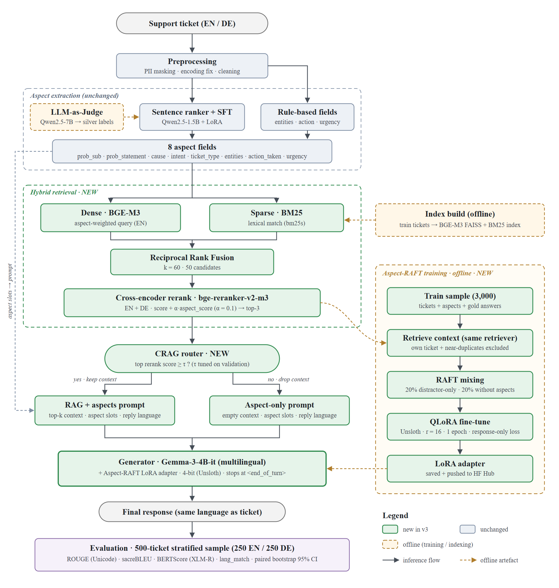

# AspectForge — Multilingual Aspect-Aware Customer Support Response Generation

Aspect-aware RAG for bilingual (EN/DE) customer-support tickets. Each ticket is
decomposed into eight structured aspect fields, and those aspects steer
retrieval, reranking and generation.

**v3** adds supervised aspect heads, a multilingual Gemma-3 generator, hybrid
retrieval, Aspect-RAFT and a CRAG router, all evaluated by a **minimal run on
Kaggle T4×2**: 500 fixed test rows (250 EN + 250 DE), six systems, paired
bootstrap confidence intervals.



*(source: `docs/architecture_v3.svg`; this replaces Figure 2 of the earlier
report)*

Results of the latest run: **[`output/report/results.md`](output/report/results.md)**
(written by `minimal_run report`, together with `results_table.csv`,
`per_row_metrics.csv` and `results_chart.png`).

---

## Models

| Role | Model | Why |
|---|---|---|
| Generator (v3) | `unsloth/gemma-3-4b-it` | multilingual, ungated, and Unsloth's build is the only safe fp16 path for Gemma on a T4 (no native bf16) |
| Generator (baseline S1) | `unsloth/gemma-2-2b-it` | the v2 generator, kept as the small-model reference |
| Dense embedder | `BAAI/bge-m3` | multilingual retrieval without E5's `query:`/`passage:` prefixes |
| Reranker | `BAAI/bge-reranker-v2-m3` | trained for EN **and** DE, so German rows are reranked instead of falling back to raw dense scores |
| Lexical retrieval | BM25 (`bm25s`) | matches the literal strings tickets quote: error codes, product names, invoice numbers |
| Aspect spans | `paraphrase-multilingual-MiniLM-L12-v2` | sentence ranking for the span aspects (CPU) |
| Aspect labels | logistic heads over BGE-M3 embeddings | replaces the Qwen SFT labels; CPU, seconds, and no GPU time on Kaggle |
| BERTScore | `xlm-roberta-large` | real BERTScore for EN+DE |

The aspect SFT adapter (`ranjan56cse/cs-support-labels`, subfolder
`sft_checkpoint`) is still reachable with `--labels sft`. The RAFT adapter is
pushed to `ranjankn/aspectforge-raft-gemma3`.

---

## The six systems

| ID | Label | What it is |
|---|---|---|
| S1 | `s1_gemma2` | Gemma-2-2B-it, RAG + aspects |
| S2 | `s2_gemma3` | Gemma-3-4B-it, RAG + aspects — the baseline every difference is measured against |
| S3 | `s3_gemma3_crag` | S2 plus the CRAG router (drop the context when retrieval is weak) |
| S4 | `s4_raft_aspect` | Aspect-RAFT adapter, RAG + aspects |
| S5 | `s5_raft_noaspect` | the same adapter, retrieval without aspects |
| S6 | `s6_gemma3_noaspect` | S2 without aspects, zero-shot — isolates the aspect effect without fine-tuning |

S2 − S6 and S4 − S5 are the two aspect ablations; `results.md` states both with
confidence intervals.

---

## Setup

```bash
pip install -r requirements.txt          # local / GPU box
pip install -r requirements-kaggle.txt   # inside a Kaggle kernel, AFTER `pip install unsloth`
```

On Kaggle, Unsloth is installed **first** and left to choose its own
torch/transformers/trl/peft; `requirements-kaggle.txt` deliberately lists none
of those.

HuggingFace login is only needed for gated models (the v3 defaults are all
ungated):

```bash
hf auth login
```

Run the local test suite before anything expensive:

```bash
pytest -q
```

---

## Minimal run on Kaggle

The whole evaluation is two Kaggle script kernels, driven from the command line
— no notebook clicking:

```bash
python scripts/kaggle_job.py push   --job prep_train      # bakes in the current commit
python scripts/kaggle_job.py wait   --job prep_train --poll 600
python scripts/kaggle_job.py pull   --job prep_train      # STATUS.json + logs/ + outputs
python scripts/kaggle_job.py push   --job generate_eval
```

Each job writes `logs/<step>.log` and updates `STATUS.json` after every step, so
a failure can be diagnosed from `pull` alone. Jobs live in `kaggle/<job>/`
(`kernel-metadata.json` + `run.py`), and `run.py` clones this repo and checks
out the exact commit that was pushed.

**Job 1 — `prep_train`** (about 3–3.5 h)

| Step | Command |
|---|---|
| splits | `python -m src.preprocessing --config config/config_preprocess.yaml` |
| samples | `python -m src.minimal_run sample` → `test_500`, `val_500`, `raft_train_3000` |
| aspects | `python -m src.aspect.aspect_extractor --input ... --out ...` (GPU 0 and GPU 1 in parallel), then `minimal_run attach_aspects` |
| index | `python -m src.retrieval.indexer --config config/retrieval_config.yaml` |
| heads | `python -m src.aspect.aspect_heads train` / `eval` |
| retrieval eval | `python -m src.retrieval.eval_retrieval --input data/minimal/val_500_with_aspects.csv --label m3_hybrid_rerank` |
| RAFT | `python -m src.step3_raft build` then `python -m src.step3_raft train --no_push` |

**Job 2 — `generate_eval`** (about 2.5–3.5 h) attaches job 1's output and runs
S1+S4, then S2+S5, then S6, two GPUs at a time; then `crag_tune`, then S3
(reusing S2's replies for every row above the threshold), then `report`.

Locally, the same steps run one at a time:

```bash
# one system
python -m src.generation.response_generator_v2 \
  --config config/generation_config.yaml \
  --sample_csv data/minimal/test_500_with_aspects.csv \
  --mode rag_aspect --model_id unsloth/gemma-3-4b-it --label s2_gemma3

# the report over several systems
python -m src.minimal_run report \
  --systems s1_gemma2 s2_gemma3 s3_gemma3_crag s4_raft_aspect s5_raft_noaspect \
  --output_dir output/generation --report_dir output/report
```

Add `--overrides config/kaggle.yaml` to any entry point to switch paths, batch
sizes and the backend to the Kaggle environment. The base configs keep relative
paths, so local runs are unaffected.

---

## Generation modes

| `--mode` | System | Notes |
|---|---|---|
| `rag_aspect` | S1, S2, S6 | RAG + aspects; `--no_aspects` turns the aspect path off (S6) |
| `rag_aspect_crag` | S3 | adds the CRAG router; `--crag_threshold` comes from `crag_tune` |
| `raft_aspect` | S4 | needs `--adapter_path` (a directory or an HF repo id) |
| `raft_rag` | S5 | the adapter without aspects |
| `baseline`, `rag`, `aspect`, `all` | — | the v2 ablations, unchanged |

`--label` names the output: `{output_dir}/{label}.csv`, which is how the report
finds each system. A `raft_*` mode without an adapter is refused; a non-RAFT
mode ignores a configured adapter, so S1–S3 really do score the base model.

---

## Metrics

Everything is computed once by `minimal_run report`, with a **paired** bootstrap
(1000 resamples, seed 42, the same resample indices for every system). A
difference is called *significant* only when the CI of the paired difference
excludes 0.

| Metric | Definition | What changed in v3, and why |
|---|---|---|
| `rouge1/2/L` | ROUGE F-measure | the scorer now uses a Unicode word tokenizer with no stemmer. rouge_score's default tokenizer strips non-ASCII, so "Größe ändern" became "gr e ndern" and two *different* German words scored as identical — German was being graded on mangled text |
| `bleu` | corpus sacreBLEU (0–100) | v2 reported only the 1-gram and 4-gram precisions and called them `bleu1`/`bleu4`. Real BLEU is now reported as `bleu`, and the precisions are renamed `bleu_p1`/`bleu_p4` so they cannot be mistaken for it |
| `bertscore_f1` | real BERTScore F1 (`xlm-roberta-large`) | v2's `bertscore_f1` was a cosine between mBERT CLS vectors, not BERTScore. That measure is kept under its honest name `cls_cosine_mbert` |
| `lang_match` | share of replies written in the ticket's language (langdetect, seeded) | new. A German ticket with English retrieved context used to get an English reply and nothing noticed |
| `ACS` | Aspect Coverage Score: per non-`none` aspect (`prob_sub`, `cause`), the best cosine between the aspect and any sentence of the reply, averaged | new. ROUGE cannot tell whether a fluent reply actually addresses the problem it was given — this is the project's own claim, made measurable |
| `AAS` | Action Acknowledgement Score: the same for `action_taken` | new; only over rows where an action was extracted |

Retrieval is scored separately, before any GPU time is spent on replies:
`eval_retrieval` reports `top1_rougeL`, `top1_cos` and `intent@3` per
configuration (`e5_dense`, `m3_dense`, `m3_hybrid`, `m3_hybrid_rerank`) into
`output/report/retrieval_table.csv`.

---

## Aspects

Eight fields per ticket: `prob_sub`, `prob_statement`, `cause`, `intent`,
`ticket_type_nli`, `entities`, `action_taken`, `urgency`.

v3 changes (plan §A):

- **Supervised heads** (`src/aspect/aspect_heads.py`) predict `intent`,
  `ticket_type` and `urgency` from the dataset's own gold `queue`, `type` and
  `priority`, using the embeddings the indexer already computed. The old SFT
  labels had collapsed: 6 of 11 sample tickets were `general_inquiry` and
  `ticket_type_nli` only ever took two of four values. `--labels heads` (the
  default) loads no GPU model at all; `--labels sft` keeps the legacy path.
- **Span clean-up** (`postprocess_spans`): `ftfy` before extraction, a
  pleasantry filter (a span that only thanks or signs off is replaced by the
  next-ranked sentence, or becomes `none`), de-duplication when `cause` repeats
  `prob_sub`, and `action_taken` must contain an action cue. An unusable span
  becomes `none`, because the checklist prompt would otherwise ask the model to
  act on it.
- **Entities** keep a single capitalised word only if the body repeats it or it
  looks like a product (a digit or camelCase). A title-case subject used to
  yield "Detected, Unauthorized, Access, Hospital, System, …".
- **Aspect checklist prompt** replaces the `Aspects : k: v | …` dump: the dump
  told the model what the ticket was about, the checklist tells it what the
  reply has to do. Aspect-RAFT trains on exactly this format.
  `aspect_prompt_style: slots` restores the old dump.

---

## Project structure

```
aspectforge/
├── src/
│   ├── minimal_run.py                    # sample | attach_aspects | crag_tune | crag_reuse | report
│   ├── step3_raft.py                     # Aspect-RAFT: build | train
│   ├── retrieval/
│   │   ├── indexer.py                    # FAISS + BM25 + dense.npy + metadata
│   │   ├── retriever.py                  # hybrid retrieval, RRF, rerank, aspect bonus, prompts
│   │   ├── inference_retriever.py        # config + batch wrapper
│   │   └── eval_retrieval.py             # retrieval-only proxy metrics
│   ├── generation/
│   │   ├── model_backend.py              # load_generator / generate for the hf and unsloth backends
│   │   └── response_generator_v2.py      # all modes and runners
│   ├── aspect/
│   │   ├── aspect_extractor.py           # spans, entities, urgency, labels (heads | sft)
│   │   └── aspect_heads.py               # train | predict | eval for the supervised heads
│   ├── baseline/baseline_t5.py           # Flan-T5-base zero-shot baseline
│   ├── step1_silver_labels.py            # LLM-as-Judge silver labels (v2)
│   ├── step2_sft.py                      # Qwen2.5-1.5B + LoRA aspect SFT (v2)
│   ├── preprocessing.py                  # stratified splits (seed 42)
│   └── utils.py                          # config merging, metrics, checklist, prompt budget, checkpointer
├── config/
│   ├── config_preprocess.yaml            # splits
│   ├── retrieval_config.yaml             # index building
│   ├── inference_retrieval_config.yaml   # retrieval at inference
│   ├── generation_config.yaml            # generator
│   ├── config_raft.yaml                  # Aspect-RAFT
│   ├── config_asp_sft.yaml               # legacy aspect SFT
│   └── kaggle.yaml                       # environment overrides, merged on top
├── kaggle/
│   ├── hello/                            # 1-minute GPU smoke job
│   ├── prep_train/                       # job 1
│   └── generate_eval/                    # job 2
├── scripts/kaggle_job.py                 # push | status | wait | pull
├── tests/                                # CPU test harness (pytest)
├── docs/
│   ├── architecture_v3.{svg,png}
│   └── samples/                          # 10-row fixtures used by the tests
├── data/{raw,processed,minimal,index}/    # not in git
├── output/{generation,aspect,raft,report}/ # not in git
├── UPGRADE_PLAN.md                       # the v3 spec
└── PROGRESS.md                           # what is done, what is next
```

---

## Configuration

Every entry point takes `--config` and an optional
`--overrides config/kaggle.yaml`, whose sections are deep-merged on top:

```yaml
# config/kaggle.yaml
paths:      { data_dir: /kaggle/input/aspectforge-data, work_dir: /kaggle/working/Code }
generation: { backend: unsloth, generation_batch_size: 8, max_input_tokens: 2560, skip_metrics: true }
retrieval:  { device: cuda, batch_size: 32 }
raft:       { n_train: 3000, max_seq_len: 2048, batch: 2, grad_accum: 8 }
```

Notable generator keys (`config/generation_config.yaml`):

```yaml
model_id            : "google/gemma-2-2b-it"
backend             : "hf"          # hf | unsloth
adapter_path        : ""            # RAFT adapter: directory or HF repo id
max_input_tokens    : 3072          # the prompt budget; context is dropped, never truncated
ctx_doc_max_chars   : 1200
reply_language_instruction: true    # "Write the reply in German, ..." before "Support reply:"
aspect_prompt_style : "checklist"   # checklist | slots
crag_threshold      : 0.30          # set by `minimal_run crag_tune`
sample_csv          : ""            # the fixed sample; overrides --input
skip_metrics        : false         # true leaves metrics to `minimal_run report`
```

Retrieval (`config/inference_retrieval_config.yaml`): `retrieval_mode: hybrid`,
`rrf_k: 60`, `n_candidates: 50`, `rerank_languages: ["en", "de"]`,
`rerank_doc_field: body`, `aspect_query_languages: ["en"]`,
`aspect_rerank_weight: 0.1`.

---

## Output files

| File | Description |
|---|---|
| `output/generation/{label}.csv` | one system's replies, prompts, `n_ctx_used`, `top_ce_score`, `route` and the eight aspect columns |
| `output/report/per_row_metrics.csv` | every metric, per system and row |
| `output/report/results_table.csv` | mean, CI and the paired difference per system/split/metric |
| `output/report/results.md` | the report: tables, takeaways, aspect contribution, ACS/AAS, CRAG routes, examples |
| `output/report/results_chart.png` | ROUGE-L / BERTScore-F1 / lang_match with CI error bars, EN vs DE |
| `output/report/retrieval_table.csv` | retrieval-only metrics per configuration |
| `output/report/aspect_table.csv` | aspect-head accuracy and macro-F1 vs the majority baseline |
| `output/report/crag_tuning.csv` | the ROUGE-L sweep over the CRAG threshold |
| `output/raft/raft_train.jsonl` | the Aspect-RAFT training set |

---

## Hardware

- Evaluation: **Kaggle T4×2** (16 GB per card, no native bf16 — hence the
  Unsloth backend for Gemma).
- Development and the v2 runs: NVIDIA RTX 4090 (24 GB), `backend: hf` with
  bf16 compute.
- The test suite, the aspect heads and the span clean-up are CPU-only.
