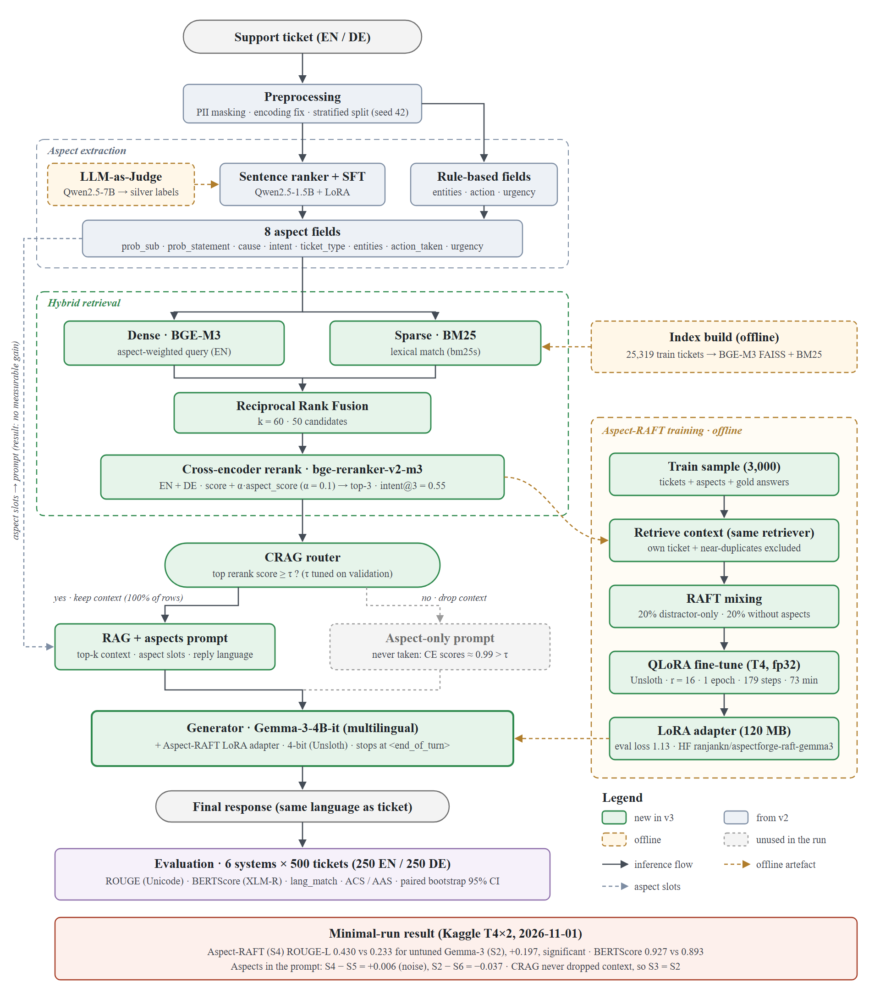
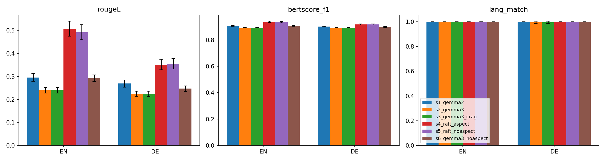

# AspectForge: Bilingual Customer-Support Reply Generation

AspectForge drafts replies to customer-support tickets in **English and German**.
For each new ticket it finds similar tickets the support team has already
answered and gives them to a language model as examples. The model is
fine-tuned to write the reply the way the team would.

> **Headline result.** Fine-tuning Gemma-3-4B on retrieved examples (RAFT)
> nearly **doubles reply quality**: ROUGE-L rose from **0.233 to 0.430**
> (+0.197, 95% CI [0.177, 0.216]) on 500 held-out tickets. It also answered in
> the ticket's language 100% of the time.
> Full write-up: **[Project report](docs/PROJECT_REPORT.md)**

---

## How it works



*Editable source: [`docs/architecture_v3.svg`](docs/architecture_v3.svg). Grey
dashed boxes are parts that are built but were never used in the final run.*

A ticket goes through five stages:

| # | Stage | What happens | Tools |
|---|---|---|---|
| 1 | **Clean** | Personal data is masked, broken encodings are fixed and the ticket text is normalised | `src/preprocessing.py` |
| 2 | **Understand** | Eight *aspects* are extracted: the problem, its cause, the intent, the ticket type, entities, the action already taken and the urgency | Qwen2.5-1.5B + LoRA, rules |
| 3 | **Retrieve** | Similar past tickets are found by meaning (dense vectors) and by exact words (BM25). The two lists are merged and a cross-encoder reranks them down to the best 3 | BGE-M3, BM25, bge-reranker-v2-m3 |
| 4 | **Decide** | A CRAG router checks how relevant the retrieved tickets are. If they look weak, it drops them and answers from the aspects alone | reranker score vs a tuned threshold |
| 5 | **Write** | Gemma-3-4B, with a RAFT fine-tuned adapter, writes the reply in the ticket's language | Gemma-3-4B-it + LoRA (Unsloth) |

**RAFT** (Retrieval-Augmented Fine-Tuning) is the training step that made the
difference. The model sees 3,000 past tickets, each with the context the
retriever would return and the real support answer as the target. 20% of the
examples contain only misleading context, so the model also learns to ignore
irrelevant documents.

---

## Results

Six systems answered the same **500 test tickets** (250 EN + 250 DE). Brackets
show 95% paired-bootstrap confidence intervals.

| ID | System | ROUGE-L | BERTScore F1 | Same language |
|---|---|---|---|---|
| S1 | Gemma-2-2B + retrieval + aspects | 0.282 [0.270, 0.295] | 0.904 | 100% |
| S2 | Gemma-3-4B + retrieval + aspects *(baseline)* | 0.233 [0.225, 0.241] | 0.893 | 99.8% |
| S3 | S2 + CRAG router | 0.233 *(identical to S2)* | 0.893 | 99.8% |
| **S4** | **RAFT adapter + retrieval + aspects** | **0.430** [0.408, 0.450] | **0.927** | 100% |
| S5 | RAFT adapter + retrieval, no aspects | 0.424 [0.402, 0.443] | 0.926 | 100% |
| S6 | Gemma-3-4B + retrieval, no aspects | 0.270 [0.260, 0.280] | 0.902 | 100% |



**What we learned**

1. **Fine-tuning is what matters.** RAFT improves ROUGE-L by +0.197 over the
   same model without training. The gain holds in English (0.240 → 0.508) and
   German (0.225 → 0.352).
2. **Aspects in the prompt don't help.** With the adapter, S4 vs S5 is +0.006,
   which is within noise. Without it they hurt: S2 scores 0.037 below S6.
3. **CRAG never drops the context.** The reranker scores almost every ticket
   above 0.99, so the router always keeps the context. A sweep over the real
   score range confirms that always using retrieval is best (0.238, against
   0.190 with no context).
4. **German is harder.** There is less German data (31% of tickets), and German
   retrieval finds weaker matches (top-1 ROUGE-L 0.22, against 0.54 for English).

All result tables are in [`results/minimal_run_2026-11-01/`](results/minimal_run_2026-11-01/)
([`results.md`](results/minimal_run_2026-11-01/results.md) is the auto-generated
report with every metric and significance test).

---

## Quick start

```bash
git clone https://github.com/ranjankndev/customer-support-response-nlp.git
cd customer-support-response-nlp
pip install -r requirements.txt
pytest -q                     # CPU test suite, about 1 minute
```

Generate replies for a sample with the trained adapter (needs a GPU):

```bash
python -m src.generation.response_generator_v2 \
  --config config/generation_config.yaml \
  --sample_csv data/minimal/test_500_with_aspects.csv \
  --mode raft_aspect --model_id unsloth/gemma-3-4b-it \
  --adapter_path ranjankn/aspectforge-raft-gemma3 \
  --label s4_raft_aspect
```

The adapter repo is currently private. Use a local adapter directory, or ask
for access.

---

## Reproduce the experiment on Kaggle (free T4×2)

The whole experiment runs as two Kaggle script jobs, driven from your terminal:

```bash
python scripts/kaggle_job.py push --job prep_train      # data, aspects, index, RAFT training
python scripts/kaggle_job.py wait --job prep_train
python scripts/kaggle_job.py pull --job prep_train
python scripts/kaggle_job.py push --job generate_eval   # 6 systems x 500 tickets + report
python scripts/kaggle_job.py wait --job generate_eval
python scripts/kaggle_job.py pull --job generate_eval
```

| Job | What it does | Time on T4×2 |
|---|---|---|
| `prep_train` | splits → fixed samples → aspect extraction → hybrid index → retrieval eval → RAFT data → RAFT training | about 3 h cold, about 1.5 h with the cached datasets |
| `generate_eval` | S1+S4, then S2+S5, then S6 (two GPUs in parallel) → CRAG tuning → S3 → report | about 2 h |

Each job clones this repo **at the exact commit that was pushed**. It writes
`STATUS.json` and `logs/<step>.log` after every step, so a failure can be
diagnosed with `pull` alone. Requirements: an authenticated Kaggle CLI, plus
the private input datasets listed in `kaggle/*/kernel-metadata.json`.

---

## Models

| Role | Model |
|---|---|
| Generator | `unsloth/gemma-3-4b-it` (+ RAFT LoRA adapter `ranjankn/aspectforge-raft-gemma3`) |
| Small-model baseline (S1) | `unsloth/gemma-2-2b-it` |
| Aspect extractor | Qwen2.5-1.5B-Instruct + LoRA (`ranjan56cse/cs-support-labels`) |
| Dense retrieval | `BAAI/bge-m3` |
| Lexical retrieval | BM25 (`bm25s`) |
| Reranker | `BAAI/bge-reranker-v2-m3` (EN + DE) |
| BERTScore | `xlm-roberta-large` |

## Metrics

| Metric | Meaning |
|---|---|
| ROUGE-1/2/L | word overlap with the real support answer (Unicode tokenizer, so German umlauts are scored correctly) |
| BERTScore F1 | similarity in meaning to the real answer (XLM-RoBERTa-large) |
| lang_match | share of replies written in the ticket's language |
| ACS / AAS | how well the reply covers the ticket's problem and cause / acknowledges the action already taken |
| intent@3 | share of the top-3 retrieved tickets that have the same intent as the query |

Every comparison uses a **paired bootstrap** (1,000 resamples, seed 42). A
difference counts as significant only if its 95% CI excludes 0.

---

## Repository layout

```
├── src/
│   ├── preprocessing.py            # stratified EN/DE splits (seed 42)
│   ├── aspect/                     # aspect extractor + supervised aspect heads
│   ├── retrieval/                  # indexer, hybrid retriever, reranker, retrieval eval
│   ├── generation/                 # model backends (hf | unsloth) and the generator
│   ├── step3_raft.py               # RAFT: build the training set, fine-tune
│   └── minimal_run.py              # samples, CRAG tuning, the report
├── config/                         # every setting; kaggle.yaml overrides paths and batch sizes
├── kaggle/                         # prep_train and generate_eval jobs
├── scripts/kaggle_job.py           # push | status | wait | pull
├── tests/                          # CPU test suite (pytest)
├── results/minimal_run_2026-11-01/ # result tables, chart and the auto report
└── docs/
    ├── PROJECT_REPORT.md           # full project report
    └── architecture_v3.{svg,png}
```

Configuration is file-driven: every entry point takes `--config`, plus an
optional `--overrides config/kaggle.yaml`, which is deep-merged on top. The code
only reads these files.

## Data

The data is the [Multilingual Customer Support Tickets](https://www.kaggle.com/datasets/tobiasbueck/multilingual-customer-support-tickets)
corpus by Tobias Bueck: 36,159 EN/DE tickets after cleaning. It is split 25,319
train / 5,420 validation / 5,420 test, stratified by language. The data files
are not stored in git.

## Hardware

- Experiments: Kaggle **T4×2**, 16 GB each. T4s have no native bf16, so RAFT
  trains in fp32 and Gemma runs through Unsloth.
- Development: RTX 4090 (`backend: hf`, bf16).
- The test suite runs on CPU.
