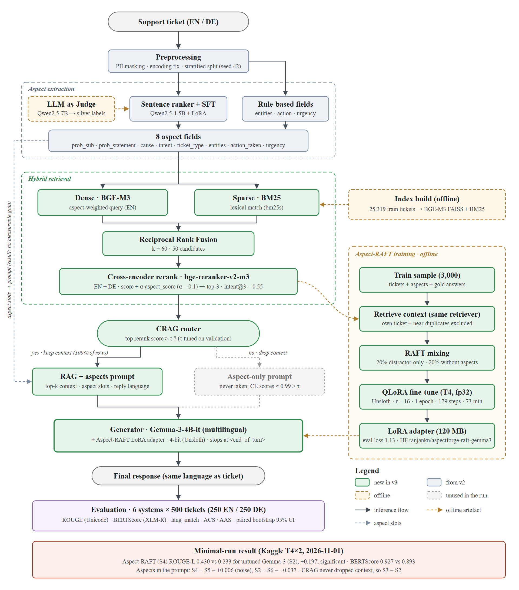
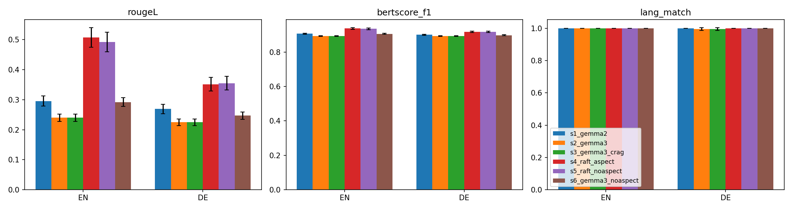

# AspectForge: Aspect-Aware Retrieval-Augmented Generation for Bilingual Customer-Support Replies

**Project report: v3 minimal run**
Repository: [ranjankndev/customer-support-response-nlp](https://github.com/ranjankndev/customer-support-response-nlp) · Experiment date: 1 November 2026 · Hardware: Kaggle 2× NVIDIA T4

---

## Abstract

Customer-support teams answer the same kinds of tickets again and again, often
in several languages. This project builds and evaluates a pipeline that drafts
replies to English and German tickets. Each ticket is broken into eight
structured *aspects*. Similar past tickets are retrieved with a hybrid
dense + lexical retriever and a multilingual cross-encoder. A Gemma-3-4B
generator then writes the reply. Three additions were tested against a
retrieval-augmented baseline: (i) aspect conditioning in the prompt, (ii) a
Corrective-RAG (CRAG) router that drops weak context, and (iii)
Retrieval-Augmented Fine-Tuning (RAFT) of a LoRA adapter on 3,000 tickets. Six
systems were evaluated on a fixed, language-stratified sample of 500 held-out
tickets, using paired bootstrap confidence intervals.

RAFT is the only addition with a large, significant effect: ROUGE-L rises from
0.233 to 0.430 (+0.197, 95% CI [0.177, 0.216]) and BERTScore F1 from 0.893 to
0.927. Aspect conditioning brings no measurable gain (+0.006 with RAFT, −0.037
without). The CRAG router never triggers, because the reranker's relevance
scores are almost always above 0.99. Part of the RAFT gain comes from learning
the length and register of the team's replies, which ROUGE rewards strongly.
This motivates the human and LLM-judge evaluation proposed as future work.

---

## 1. Introduction

### 1.1 Problem

A support agent answering a ticket usually needs three things: an
understanding of what the customer is asking, knowledge of how similar issues
were resolved before, and a reply in the customer's language and the company's
tone. Large language models can write fluent text. Without grounding, though,
they produce generic or wrong answers, and they often reply in English to a
German ticket.

### 1.2 Approach

AspectForge combines three ideas:

- **Aspect extraction.** The ticket is decomposed into eight fields (problem
  subject, problem statement, cause, intent, ticket type, entities, action
  already taken, urgency). The aim is to steer retrieval and generation towards
  what the reply must address.
- **Hybrid retrieval with reranking.** Past tickets are retrieved both by
  meaning and by exact terms such as product names and error codes. A
  multilingual cross-encoder then reranks them.
- **Retrieval-Augmented Fine-Tuning.** The generator is trained on examples
  that pair a ticket and its retrieved context with the real support answer.
  Some examples contain only misleading context, so the model learns when to
  use the context and when to ignore it.

### 1.3 Research questions

| RQ | Question | Systems compared |
|---|---|---|
| RQ1 | Does RAFT fine-tuning improve replies over the same model used zero-shot? | S4 vs S2 |
| RQ2 | Do aspects in the prompt improve replies, with and without fine-tuning? | S2 vs S6, S4 vs S5 |
| RQ3 | Does a CRAG router that drops weak context help? | S3 vs S2 |
| RQ4 | How does a newer, larger untuned model compare with the previous small generator? | S2 vs S1 |

### 1.4 Contributions

1. An end-to-end, configuration-driven pipeline for bilingual reply generation,
   reproducible on free Kaggle hardware through two scripted jobs.
2. A controlled six-system comparison with paired bootstrap statistics,
   reported overall and per language.
3. Corrected metrics for German. The default ROUGE tokenizer strips non-ASCII
   characters, and an earlier "BERTScore" was really a CLS-vector cosine.
4. A released LoRA adapter for Gemma-3-4B trained with RAFT.

---

## 2. Related work

- **Retrieval-augmented generation (RAG).** Lewis et al. (2020) condition a
  generator on retrieved passages. AspectForge uses RAG as its baseline (S1, S2,
  S6).
- **Hybrid retrieval.** Dense embeddings capture paraphrase. BM25 captures exact
  tokens. Reciprocal Rank Fusion (Cormack et al., 2009) merges ranked lists
  without score calibration. BGE-M3 (Chen et al., 2024) supplies multilingual
  dense vectors, and bge-reranker-v2-m3 the cross-encoder.
- **RAFT.** Zhang et al. (2024) fine-tune a model on question + retrieved
  documents, including distractor-only examples, so it learns to use relevant
  context and ignore the rest.
- **Corrective RAG (CRAG).** Yan et al. (2024) score retrieval quality and fall
  back when it is poor. Here the fallback is an aspect-only prompt.
- **Parameter-efficient fine-tuning.** LoRA (Hu et al., 2021) and QLoRA
  (Dettmers et al., 2023) make fine-tuning a 4B model possible on a 16 GB GPU.
- **Evaluation.** ROUGE (Lin, 2004) for lexical overlap and BERTScore
  (Zhang et al., 2020) for semantic similarity.

---

## 3. Data

| Property | Value |
|---|---|
| Source | Multilingual Customer Support Tickets (T. Bueck, Kaggle), a synthetic help-desk corpus |
| Rows after cleaning | 36,159 (25,072 EN · 11,087 DE) |
| Fields used | subject, body, answer (gold reply), queue, type, priority, language |
| Split (seed 42, stratified by language) | train 25,319 · validation 5,420 · test 5,420 |
| Retrieval index | all 25,319 training tickets |

**Fixed evaluation samples.** For a controlled comparison on limited GPU time,
three fixed samples are drawn once, with a leakage guard so that no ticket
appears in two samples:

| Sample | Rows | Used for |
|---|---|---|
| `test_500` | 500 (250 EN + 250 DE) | final evaluation of all six systems |
| `val_500` | 500 (250 EN + 250 DE) | retrieval metrics, aspect-head evaluation, CRAG tuning (150 rows) |
| `raft_train_3000` | 3,000, from train | RAFT training set (5% held out for validation loss) |

---

## 4. Method

*Figure 1. AspectForge as it ran in the experiment. Grey dashed elements are
implemented but were never used in the run.*

### 4.1 Preprocessing

`src/preprocessing.py` masks PII, repairs mis-encoded characters (`ftfy`) and
writes language-stratified splits. Each ticket keeps a global id. An earlier
version renumbered ids within each split, which made ids from test and
validation collide. The leakage guard caught this in the first run.

### 4.2 Aspect extraction

Eight aspect fields are produced per ticket:

- **Span aspects** (`prob_sub`, `prob_statement`, `cause`, `action_taken`) come
  from a multilingual sentence ranker, followed by clean-up rules: pleasantries
  and duplicate spans are removed, and an action span must contain an action
  cue.
- **Label aspects** (`intent`, `ticket_type`) come from a Qwen2.5-1.5B-Instruct
  LoRA model. It was fine-tuned in v2 on silver labels from a Qwen2.5-7B judge.
- **Rule-based aspects** (`entities`, `urgency`).

Supervised logistic heads over BGE-M3 embeddings were also trained on the
dataset's gold `queue`, `type` and `priority`, and evaluated as an alternative
labeller (§6.6).

### 4.3 Hybrid retrieval

1. **Dense:** BGE-M3 embeddings in a FAISS index. For English, the query is
   weighted towards the aspect fields.
2. **Sparse:** BM25 (`bm25s`) over the ticket text.
3. **Fusion:** Reciprocal Rank Fusion (k = 60) over 50 candidates.
4. **Rerank:** bge-reranker-v2-m3 for both EN and DE, plus a small aspect
   bonus: score + 0.1 · aspect_score. The top 3 tickets become the context.

### 4.4 CRAG router

If the top reranker score is below a threshold τ, the retrieved context is
dropped and the reply is generated from the ticket and its aspects alone. τ is
chosen on 150 validation tickets by generating both variants once and
re-scoring each candidate threshold offline.

### 4.5 Prompt

The prompt contains the ticket and up to three retrieved tickets with their
answers. When aspects are on, it adds an aspect *checklist* stating what the
reply must cover. It closes with an explicit instruction about the reply
language. The prompt is limited to 2,560 tokens: whole context documents are
dropped to fit, and nothing is truncated mid-text.

### 4.6 Aspect-RAFT fine-tuning

| Setting | Value |
|---|---|
| Base model | `unsloth/gemma-3-4b-it`, 4-bit (Unsloth) |
| Training examples | 3,000 tickets (2,850 train / 150 validation) |
| Context | top-3 from the same retriever, excluding the ticket itself and near-duplicates (cosine ≥ 0.97) |
| RAFT mixing | 20% distractor-only context · 20% without aspects |
| LoRA | r = 16, α = 16, dropout 0 |
| Optimisation | lr 2e-4, 1 epoch, batch 2 × grad-accum 8 (179 steps), warm-up 3% |
| Loss | on the response tokens only |
| Precision | fp32 on T4 (no native bf16, see Appendix A) |
| Time | 72.8 min on one T4 |
| Final loss | train 1.189 · validation 1.127 |
| Adapter size | 120 MB |

### 4.7 Generation

Decoding is greedy (`do_sample: false`), with at most 200 new tokens, stopping
at Gemma's `<end_of_turn>`. Generation runs through Unsloth in 4-bit, two
systems in parallel, one per T4.

---

## 5. Experimental setup

### 5.1 Systems

| ID | Generator | Retrieval | Aspects | Fine-tuned | Purpose |
|---|---|---|---|---|---|
| S1 | Gemma-2-2B-it | ✓ | ✓ | — | previous generator (v2) |
| S2 | Gemma-3-4B-it | ✓ | ✓ | — | **baseline** |
| S3 | Gemma-3-4B-it | ✓ + CRAG | ✓ | — | effect of CRAG (RQ3) |
| S4 | Gemma-3-4B-it + RAFT | ✓ | ✓ | ✓ | full system (RQ1) |
| S5 | Gemma-3-4B-it + RAFT | ✓ | — | ✓ | aspects with fine-tuning (RQ2) |
| S6 | Gemma-3-4B-it | ✓ | — | — | aspects without fine-tuning (RQ2) |

### 5.2 Metrics

| Metric | Definition |
|---|---|
| ROUGE-1/2/L | F-measure against the gold reply, with a Unicode word tokenizer and no stemming |
| BERTScore F1 | XLM-RoBERTa-large |
| lang_match | share of replies in the ticket's language (langdetect, seeded) |
| ACS | Aspect Coverage Score: for each extracted `prob_sub` and `cause`, the best cosine against any sentence of the reply, averaged |
| AAS | Action Acknowledgement Score: the same for `action_taken`, only on rows where an action was extracted (n = 130) |
| top1_rougeL, top1_cos, intent@3 | retrieval quality before generation: overlap / cosine between the top-1 retrieved answer and the gold answer, and the share of the top 3 with the query's intent |

### 5.3 Statistics

Every system is scored on the same 500 tickets. Confidence intervals come from
a **paired bootstrap**: 1,000 resamples, seed 42, with the same resample indices
for every system. A difference counts as significant only when the 95% CI of
the paired difference excludes 0.

### 5.4 Compute

| Job | Steps | Wall time |
|---|---|---|
| `prep_train` | splits, samples, aspects, index, retrieval eval, RAFT build, RAFT training | about 1 h 30 min (aspects and index reused from an earlier identical run; about 51 min more cold) |
| `generate_eval` | S1–S6 generation, CRAG tuning, report | 2 h 02 min |

All runs were on the free Kaggle tier. Each job checks out the exact git commit
it was pushed from: `4338cc9` for training and `17dc54c` for evaluation.

---

## 6. Results

### 6.1 Retrieval (validation, n = 500)

| Split | top1_rougeL | top1_cos | intent@3 |
|---|---|---|---|
| All | 0.380 [0.355, 0.407] | 0.857 [0.847, 0.868] | 0.551 [0.525, 0.581] |
| EN | 0.539 [0.503, 0.575] | 0.890 [0.875, 0.904] | 0.551 [0.509, 0.595] |
| DE | 0.221 [0.192, 0.248] | 0.825 [0.811, 0.839] | 0.552 [0.508, 0.593] |

Retrieval finds the right *kind* of ticket equally well in both languages
(intent@3 ≈ 0.55). For English, though, the best retrieved answer overlaps
with the gold answer far more: top-1 ROUGE-L is 0.54 for EN against 0.22 for
DE. The German pool is smaller (7,763 vs 17,556 training tickets), so close
near-duplicates are rarer.

### 6.2 Main results (test, n = 500)

| System | ROUGE-1 | ROUGE-2 | ROUGE-L | BERTScore F1 | lang_match |
|---|---|---|---|---|---|
| S1 Gemma-2-2B | 0.390 | 0.157 | 0.282 [0.270, 0.295] | 0.904 | 1.000 |
| S2 Gemma-3-4B *(baseline)* | 0.356 | 0.119 | 0.233 [0.225, 0.241] | 0.893 | 0.998 |
| S3 S2 + CRAG | 0.356 | 0.119 | 0.233 [0.225, 0.241] | 0.893 | 0.998 |
| **S4 RAFT + aspects** | **0.518** | **0.295** | **0.430** [0.408, 0.450] | **0.927** | **1.000** |
| S5 RAFT, no aspects | 0.510 | 0.290 | 0.424 [0.402, 0.443] | 0.926 | 1.000 |
| S6 no aspects | 0.392 | 0.146 | 0.270 [0.260, 0.280] | 0.902 | 1.000 |

*Figure 2. ROUGE-L, BERTScore F1 and lang_match by language, with 95% CIs.*

### 6.3 Per language (ROUGE-L)

| System | EN (n = 250) | DE (n = 250) |
|---|---|---|
| S1 | 0.296 | 0.269 |
| S2 / S3 | 0.240 | 0.225 |
| **S4** | **0.508** [0.475, 0.540] | **0.352** [0.329, 0.373] |
| S5 | 0.492 | 0.355 |
| S6 | 0.292 | 0.247 |

### 6.4 Paired differences against S2 (ROUGE-L)

| Comparison | Δ ROUGE-L | 95% CI | Significant |
|---|---|---|---|
| S4 − S2 (RAFT) | **+0.197** | [0.177, 0.216] | yes |
| S5 − S2 | +0.191 | [0.170, 0.210] | yes |
| S1 − S2 | +0.050 | [0.041, 0.059] | yes |
| S6 − S2 (removing aspects) | +0.037 | [0.031, 0.043] | yes |
| S3 − S2 (CRAG) | 0.000 | — | identical outputs |

S4 beats S2 on 83.4% of individual tickets (median per-ticket gain +0.142).

### 6.5 Aspect ablations

| Comparison | Δ ROUGE-L | Δ BERTScore |
|---|---|---|
| S2 − S6 (aspects, no fine-tuning) | −0.037 | −0.009 |
| S4 − S5 (aspects, with RAFT) | +0.006 | +0.001 |

### 6.6 Aspect quality

**Aspect coverage of the replies.**

| System | ACS | AAS |
|---|---|---|
| S1 | 0.796 | 0.821 |
| S2 | 0.805 | 0.789 |
| S4 | 0.693 | 0.649 |

S4's coverage is 0.112 lower than S2's (ACS, CI [−0.123, −0.101], significant).

**Aspect labellers (validation, n = 500).** The supervised heads beat the
majority-class baseline on macro-F1 for all three targets:

| Head | Gold column | Accuracy | Macro-F1 | Majority F1 |
|---|---|---|---|---|
| intent | queue | 0.300 | 0.256 | 0.046 |
| ticket_type | type | 0.804 | 0.804 | 0.143 |
| urgency | priority | 0.462 | 0.448 | 0.177 |

The SFT labels used in the run are skewed: `intent` takes 7 values, with
`general_inquiry` at 40.6%, and `ticket_type_nli` puts 50.4% of tickets in
`complaint`.

### 6.7 CRAG

On the planned grid (τ = 0.05 … 0.60), every validation ticket kept its
context, because no top reranker score fell below 0.80 (median 0.998; the
lowest on the test set is 0.70). The
saved pairs were re-scored over the real score range:

| τ | ROUGE-L | Share keeping context |
|---|---|---|
| 0.00 | 0.2380 | 100% |
| 0.90 | 0.2381 | 98.0% |
| 0.99 | 0.2325 | 79.3% |
| 0.999 | 0.2233 | 45.3% |
| > 1 (never retrieve) | 0.1903 | 0% |

Always retrieving is effectively optimal. The 0.0001 edge at τ = 0.90 is noise,
and every stricter threshold makes replies worse.

### 6.8 Reply length

| | Gold | S1 | S2 | S4 | S5 | S6 |
|---|---|---|---|---|---|---|
| Mean words per reply | 60.7 | 63.8 | 99.6 | 61.6 | 61.2 | 91.1 |

### 6.9 Qualitative example

*Ticket (EN): "Problem with Video Calls". Users report frequent disconnections
in Google Meet, WeChat and Evernote. They have already restarted services,
optimised database queries and increased server capacity, and ask for help.*

| | Reply (shortened) | ROUGE-L |
|---|---|---|
| Gold | "We will review the issue and contact you shortly." | — |
| S2 | "Dear Customer, we understand the urgency of this situation … we need to escalate this immediately … we require a full system dump …" (143 words) | 0.07 |
| S4 | "We will review the issue and contact you shortly." | 1.00 |

This is the largest per-ticket gain in the sample. S4 has learned that the team
answers such tickets with a short acknowledgement, while S2 writes a long,
speculative reply.

---

## 7. Discussion

**RQ1: RAFT works, and much of the gain is style and length.** The fine-tuned
adapter is the only component with a large effect, and it holds in both
languages and on both lexical and semantic metrics. Section 6.8 shows part of
the mechanism. Untuned Gemma-3 writes replies about 65% longer than the team's,
while RAFT matches their length almost exactly. Length mismatch costs ROUGE
precision directly, so some of the +0.197 reflects register imitation rather
than better problem-solving. The example in §6.9 shows both sides. The tuned
reply is what the team would send, but it gives the customer no information. A
generic acknowledgement fits this synthetic dataset; whether it is the right
target for a real help desk is another question.

**RQ4: model size does not help without tuning.** Gemma-2-2B beats Gemma-3-4B
zero-shot (0.282 vs 0.233). Its replies happen to be close to the gold length
(63.8 words), which again points to length as a confound in overlap metrics.

**RQ2: aspects do not earn their place in the prompt.** Without fine-tuning,
the aspect checklist lowers ROUGE-L and BERTScore and lengthens replies: S2 at
99.6 words against S6 at 91.1. The model treats the checklist as a list of
things to discuss at length. With RAFT the aspects are neutral. The model has
already learned what a reply should contain from the examples. Aspects do raise
*coverage*: the untuned systems score higher ACS. But the gold replies
themselves do not mention every aspect, so higher coverage does not mean closer
to the reference. ACS and ROUGE pull in different directions here.

**RQ3: CRAG is redundant when retrieval is strong.** The reranker is confident
on almost every ticket, and the no-context fallback is clearly worse (−0.048
ROUGE-L). In a corpus where every ticket has close relatives in the index,
there is nothing for CRAG to correct. It might help on out-of-domain tickets,
which this test set does not contain.

**German lags English, and the gap comes from retrieval.** Both languages gain
from RAFT, but German ends lower (0.352 vs 0.508). The retrieval table shows
why: German retrieval has the right intent as often as English, but its best
match is much less similar to the gold answer. A larger German pool or
cross-lingual retrieval (German tickets retrieving English answers) are the
obvious next steps.

---

## 8. Limitations and threats to validity

1. **Automatic metrics only.** ROUGE and BERTScore reward similarity to one
   reference reply. They do not measure helpfulness or correctness, and they
   are sensitive to length (§6.8). No human or LLM-judge evaluation was run.
2. **Synthetic data.** The corpus is generated and contains many templated
   answers (§6.9), which favours a fine-tuned model that learns the templates.
3. **One run, one seed.** Training and sampling ran once. The CIs cover
   sampling of test tickets, not training randomness.
4. **Sample size.** 500 test tickets, 250 per language. Small differences, such
   as S4 vs S5, cannot be resolved.
5. **Aspect labels.** The SFT intent labels are skewed (§6.6), which may
   understate what better aspects could contribute.
6. **CRAG tuning range.** The planned threshold grid did not cover the
   reranker's score range. The conclusion comes from the offline re-scoring
   (§6.7), not from a generated S3 with an effective threshold.

---

## 9. Future work

- **Judge-based evaluation:** an LLM-as-judge or a small human study rating
  helpfulness, correctness and tone, with length-controlled comparisons.
- **Length-normalised metrics:** report ROUGE recall and precision separately,
  or compare replies of matched length.
- **Better German retrieval:** cross-lingual retrieval and a larger German
  index.
- **Aspects in training only:** use aspects to select and weight RAFT
  examples, instead of putting them in the prompt.
- **Several seeds** for RAFT, to separate training variance from the effect.
- **CRAG on harder data:** out-of-domain or adversarial tickets, with a
  quantile-based threshold grid.

---

## 10. Conclusion

On a bilingual support corpus, retrieval-augmented fine-tuning of a 4B model on
3,000 examples nearly doubles reply similarity to the team's real answers, and
the effect holds in both languages. It is trainable in about 73 minutes on a
free T4. The other two additions, aspect conditioning and corrective routing,
gave no measurable improvement on this data. The main open question is how much
of RAFT's gain is better answers rather than better imitation of the team's
style. Answering it needs evaluation beyond reference overlap.

---

## 11. Reproducibility

| Item | Location |
|---|---|
| Code | this repository, branch `v3-minimal-run`: training `4338cc9`, evaluation `17dc54c` |
| Configuration | `config/*.yaml`, with Kaggle overrides in `config/kaggle.yaml` |
| Jobs | `kaggle/prep_train`, `kaggle/generate_eval`, driven by `scripts/kaggle_job.py` |
| Results | `results/minimal_run_2026-11-01/` (tables, per-row metrics, chart, auto report) |
| RAFT adapter | Hugging Face `ranjankn/aspectforge-raft-gemma3` (private) |
| Tests | `pytest -q` (308 tests, CPU) |

---

## Appendix A: Engineering notes

Getting the pipeline to run on free T4 GPUs took nine training-job runs and two
evaluation-job runs. The issues found and fixed:

| Issue | Cause | Fix |
|---|---|---|
| Leakage guard failed (61 shared ids) | ids renumbered within each split | keep global ids (`renumber_idx: false`) |
| Out of memory in retrieval eval and generation | the Kaggle image's JAX/TF reserve most of a T4 on import | `XLA_PYTHON_CLIENT_PREALLOCATE=false`, `USE_TF/USE_JAX=0`, smaller rerank batch |
| `intent@3 = 0` | hits labelled only with a queue were never compared | compare queue-only hits with the query's gold queue |
| RAFT: "doesn't support bf16" | T4 (sm 7.5) has no native bf16 | precision resolved from GPU capability |
| RAFT: grad-scaler error on BFloat16 | Unsloth forces fp32 for Gemma-3 but leaves some layers in bf16; the fp16 grad scaler then fails | plain fp32 below Ampere, LoRA weights cast to fp32 |
| An hour of aspect extraction on every retry | — | cached aspect/index/RAFT datasets, reused only if the samples are byte-identical |

## Appendix B: References

- Chen, J. et al. (2024). *BGE M3-Embedding: Multi-Lingual, Multi-Functionality, Multi-Granularity Text Embeddings.*
- Cormack, G., Clarke, C., Büttcher, S. (2009). *Reciprocal Rank Fusion Outperforms Condorcet and Individual Rank Learning Methods.* SIGIR.
- Dettmers, T. et al. (2023). *QLoRA: Efficient Finetuning of Quantized LLMs.* NeurIPS.
- Hu, E. et al. (2021). *LoRA: Low-Rank Adaptation of Large Language Models.*
- Lewis, P. et al. (2020). *Retrieval-Augmented Generation for Knowledge-Intensive NLP Tasks.* NeurIPS.
- Lin, C.-Y. (2004). *ROUGE: A Package for Automatic Evaluation of Summaries.*
- Yan, S.-Q. et al. (2024). *Corrective Retrieval Augmented Generation.*
- Zhang, T. et al. (2020). *BERTScore: Evaluating Text Generation with BERT.* ICLR.
- Zhang, T. et al. (2024). *RAFT: Adapting Language Model to Domain Specific RAG.*
